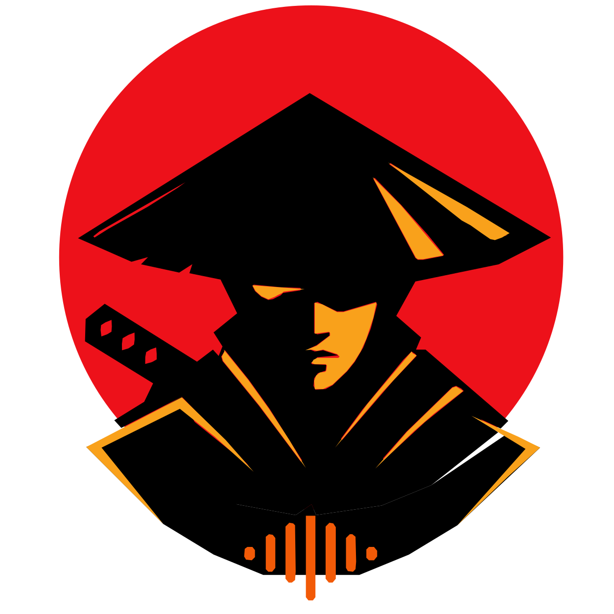
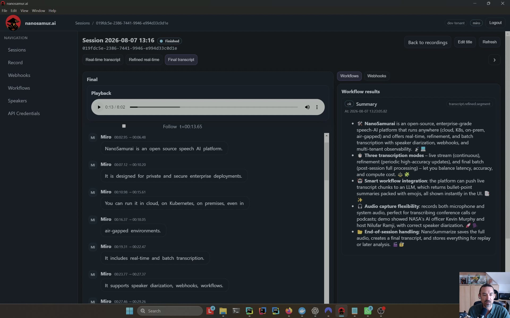
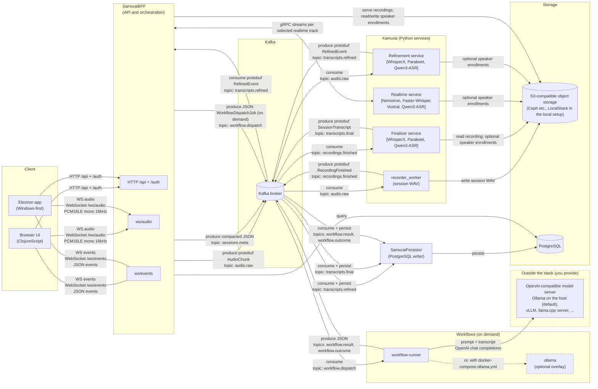
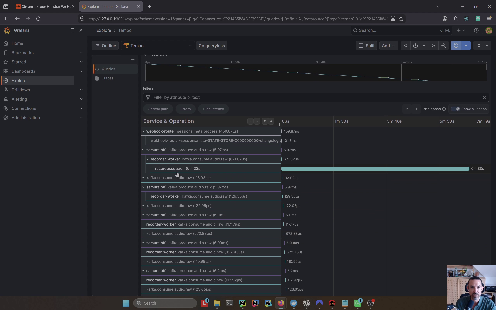

# [nanosamur.ai](https://nanosamur.ai)
<sub>Guarding Your Sensitive Conversations - Your voice. Your control.</sub>

## **Complete speech AI platform**

nanosamur.ai guards sensitive conversations in infrastructure you control. It
is a self-hosted transcription platform for open speech models.


- open source
- production-grade, distributed architecture
- live and batch transcription (incl. recording storage)
- speaker labels (diarization)
- [model agnostic](#model-pipelines-in-the-supplied-stack) (e.g. Nemotron, Parakeet, Whisper, Voxtral, Qwen ASR)
- multitenancy support
- LLM workflows & webhooks
- sign-in, user roles, sharing
- playback
- corrections
- API & SDK
- browser UI + windows Electron app
- observability


Running one speech model to perform ASR is easy - the hard part is if you want to run it for your organization at scale and in secure manner and with good observability stack. 
That is what nanosamur.ai does.

This is the public front-door repository for running Nanosamurai locally
with Docker Compose. Service images are pulled from `ghcr.io/nanosamurai/*` and
pinned by source SHA.

**You need** a GPU (CPU-only support coming, if you want it, create a ticket), Docker and disk space for images
and models. The default models need no Hugging Face token.

```bash
git clone https://github.com/nanosamurai/nanosamurai.git
cd nanosamurai
cp .env.example .env
docker compose up -d
```

Then open <http://127.0.0.1:8000/live>, choose **Microphone** and **Record
now**. The first start downloads the models and takes several minutes. The
[Quickstart](#quickstart) has the checks and the Windows notes.

## Demo - See it in action

<a href="https://nanosamur.ai/#demo">
  
</a>

[Watch nanosamur.ai](https://nanosamur.ai/#demo) turn a live conversation into speaker-aware transcripts, workflow results, a searchable final record, and a fully traced session.

## [Architecture](docs/architecture.md)



Each speech-service box groups independently deployed, selectable tracks for
that stage; brackets list the supported model pipelines. Multiple selected
tracks produce separate labelled results. The [model matrix](#model-pipelines-in-the-supplied-stack)
below covers default and optional providers, model versions, alignment, and
diarization (pyannote or Sortformer). Speaker-enrollment access applies only to
pipelines that support it.

The stack consists of:

- [xamurai](https://github.com/nanosamurai/xamurai) contains the speech services:
  - `nemotron_rtservice`, `rtservice` (Faster-Whisper), `voxtral_rtservice`, and `qwen_rtservice`: realtime transcription.
  - `whisperx_worker`: one pipeline with refinement and finalizer entrypoints,
    built with `Dockerfile.refinement` and `Dockerfile.finalizer`.
  - `parakeet_worker`: Parakeet refinement and finalization with embedded Sortformer.
  - `qwen_worker`: batched vLLM refinement/finalization with pyannote speaker turns.
  - `nemo_speech_native`: native bindings and a shared Docker base for Nemotron and Parakeet.
  - `recorder_worker`: session audio storage.
  - `xamurai_serving.finalization`: the shared Kafka and recording loop for finalizers.
  - `xamurai_serving.refinement` and `refinement_runtime`: shared window buffering,
    publication and recovery for WhisperX, Parakeet and Qwen refinement.
- [samuraibff](https://github.com/nanosamurai/samuraibff) — HTTP/WebSocket API,
  browser UI, authentication, and orchestration
- [samuraipersistor](https://github.com/nanosamurai/samuraipersistor) —
  Kafka-to-PostgreSQL transcript persistence
- [nanosamurai-sdk](https://github.com/nanosamurai/nanosamurai-sdk) — Python
  SDK and CLI

Kafka carries audio and transcript events. PostgreSQL stores session and
transcript data. The Compose stack uses LocalStack for S3-compatible recording and
speaker-enrollment storage; deployments can configure another S3-compatible
provider, such as AWS S3, Ceph RADOS Gateway, or MinIO.

See the [architecture guide](docs/architecture.md) for the request flow and
Community Edition boundary, including the object-storage replacement boundary.
API consumers should start with
[APIs and extension points](docs/apis-and-extension-points.md) for the generated
OpenAPI contract, Swagger UI, and BFF-owned protocol documentation.

## Supported Models

Realtime transcription gives you text while you speak. Refinement processes
short audio windows during the session. Final processing uses the complete
recording after you stop.

You can choose different models for each stage or use several models together.
Each model returns a separate result from the same audio.
This lets you compare live, refined, and final transcripts for your language and task.

The default stack uses NVIDIA Nemotron for live text and NVIDIA Parakeet for
refined and final transcripts. They are fast and accurate in English and need no
Hugging Face token. Add Whisper, Voxtral or Qwen with an overlay when you need
more languages, enrolled speaker names, or a comparison on the same audio.

### Model pipelines in the supplied stack

| Model family | Models | Available output | Setup guide |
| --- | --- | --- | --- |
| Nemotron | NVIDIA Nemotron 3.5 ASR streaming | Realtime; on by default | [Nemotron](docs/models/nemotron.md) |
| Parakeet | NVIDIA Parakeet TDT v3 with Sortformer speaker labels | Refined and final; on by default | [Parakeet](docs/models/parakeet.md) |
| Whisper | faster-whisper; WhisperX with pyannote | Realtime, refined, and final; `docker-compose.whisper.yml` | [Whisper](docs/models/whisper.md) |
| Voxtral | Mistral Voxtral Mini 4B Realtime 2602 | Realtime, 13 languages; no Hugging Face token | [Voxtral](docs/models/voxtral.md) |
| Qwen | Qwen3-ASR | Realtime, refined, and final; `docker-compose.qwen.yml`, `docker-compose.qwen-workers.yml` | [Qwen](docs/models/qwen.md) |

The [model guide](docs/models/README.md) explains how to add, select, or stop each model.
All model families have published container images. Each guide describes its setup.

### Demo: Running 2 models in parallel

<a href="https://nanosamur.ai/#demo">
  
</a>

## How it compares

Many good open-source projects turn speech into text. Pick the one that fits
your job:

| You want | Look at |
| --- | --- |
| Dictation into any app on your computer | [Handy](https://github.com/cjpais/Handy), [OpenWhispr](https://github.com/OpenWhispr/openwhispr) |
| Meeting notes for one person, in a desktop app | [Meetily](https://github.com/Zackriya-Solutions/meetily) |
| File transcription in a desktop app | [Buzz](https://github.com/chidiwilliams/buzz), [Vibe](https://github.com/thewh1teagle/vibe), [noScribe](https://github.com/kaixxx/noScribe) |
| A real-time speech server to put behind your own application | [WhisperLiveKit](https://github.com/QuentinFuxa/WhisperLiveKit), [Speaches](https://github.com/speaches-ai/speaches) |
| A Python library: Whisper with word timings and speakers | [WhisperX](https://github.com/m-bain/whisperX) |
| A self-hosted team app for recorded files | [Speakr](https://github.com/murtaza-nasir/speakr) |
| Bots that join online meetings and transcribe them | [Vexa](https://github.com/Vexa-ai/vexa) |

nanosamur.ai does a different job. It is a shared platform with a set of services that can host several
open speech models and lets you pick one or more for live text and for the final
transcript. It keeps the recordings and transcripts, and lets a team correct
and share them. Each component can scale independently.
Choose something else if you have no NVIDIA GPU, need a Mac or CPU-only setup, or want a single
binary.


## Quickstart

Prerequisites:

- Docker Desktop or Docker Engine
- Docker Compose v2
- free disk space for the selected images and speech models
- an NVIDIA container runtime and suitable GPU

Create the local environment file:

```bash
cp .env.example .env
```

Windows PowerShell:

```powershell
Copy-Item .env.example .env
```

Start the stack:

```bash
docker compose pull
docker compose up -d
docker compose ps --all
```

Open <http://127.0.0.1:8000/live>, select **Microphone**, and choose
**Record now**. There is no sign-in: the top bar shows **Local mode**.
Realtime results appear first; refined and final results arrive
asynchronously.

Model downloads and cold initialization can take several minutes. The speech
services request `gpus: all`; the default stack requires an NVIDIA GPU available
to Docker. The Whisper and Qwen overlays also need a least-privilege `HF_TOKEN`
in `.env` for the gated pyannote models.

See
[Getting started](docs/getting-started.md) for success checks,
Windows/Linux instructions, the tested hardware disclosure, observability, and
safe reset commands.

## Workflows

A workflow runs your prompt over a finished transcript, for example *summarize
this meeting and list the action items*. Create workflows on the **Workflows**
page, then run one from a recording's **Workflows** panel or with
`POST /api/recordings/{id}/workflows/{workflow_id}/runs`. The result is stored
with the session.

The stack includes the workflow runner, which calls any OpenAI-compatible model
server. It does not start a model for you. By default it uses Ollama on your
computer:

```bash
ollama pull qwen2.5:7b-instruct
```

With Docker Desktop on Windows or macOS this works with Ollama's default
settings; Linux needs one Ollama setting. To run Ollama inside the stack
instead, add the `docker-compose.ollama.yml` overlay. Without a reachable model
server the rest of the stack works normally, and workflow runs fail after about
two minutes.

Community Edition runs workflows only when you start them: there is no
automatic workflow routing during a recording and no webhook delivery. See
[Local LLM workflows](docs/local-llm-workflows.md) for setup, model choice,
settings, and security notes.

## Optional observability



Start the local observability services with:

```bash
docker compose -f docker-compose.yml -f docker-compose.observability.yml up -d
```

The stack provisions Grafana with Prometheus, Loki, and Tempo data sources.
Prometheus also scrapes NVIDIA GPU utilization, framebuffer memory, temperature,
and power metrics from the bundled DCGM exporter.
Kafka carries W3C trace context so asynchronous session work can be correlated
across SamuraiBFF, the Python workers, SamuraiPersistor, Kafka, and PostgreSQL.

See [Operations and observability](docs/operations-and-observability.md) for
endpoints, available signals, trace behavior, and current limitations.

## FAQ

**Why Kafka, for transcription?**
One audio stream goes to three passes, and sometimes to more than one model in
a pass. Each reads it from the log at its own pace, so a slow final pass never
holds up live text, and a finished recording can be processed again with
another model. The cost is more containers than a single-process tool.

**Which model should I use?**
Start with the defaults, Nemotron for live text and Parakeet for the rest. If
they struggle with your language, accents or vocabulary, add another model and
try it. Re-transcribe a recording you already have, or select two models for
one session and compare them on the same speech. Then set the one that works as
your default.

**Do I need an NVIDIA GPU?**
Yes. There is no CPU or Apple Silicon path today. In our release rehearsal on a
24 GB laptop GPU, the default models used about 3.6 GB of GPU memory. That is a
tested setup, not a minimum. Optional models need more; the Voxtral guide
suggests a 24 GB GPU as a starting point.

**Which languages?**
This stack tests the default models with English. Their model cards list more:
Parakeet TDT v3 lists 25 European languages. Voxtral covers 13 languages, and
Whisper covers many more. Try the models on your own audio before you choose
one.

**How many speakers?**
The default refined and final passes label up to four speakers with
Sortformer. For more, use the Whisper or Qwen overlay, which use pyannote and
need a Hugging Face token. Live text has no speaker labels by default; they
arrive with the refined text a few seconds later.

**Does audio leave my machine?**
The speech models run in local containers. The workflow runner sends a
transcript only to the model server you configure, which is Ollama on your
computer by default. The first start downloads container images and model
weights.

**Can my team use it?**
It has sign-in, organizations, roles and sharing, and each component runs as its own
service. Before other people use it, turn on [sign-in](docs/authentication.md) and read
[Deployment and security boundaries](docs/deployment-and-security.md).

**What about model licences?**
The code is Apache-2.0. Each model has its own licence, and the
[model guides](docs/models/README.md) link the model cards. Check them before
you use a model commercially.

## Documentation

- [Documentation index](docs/README.md)
- [Getting started](docs/getting-started.md)
- [Choose models](docs/models/README.md)
- [Local LLM workflows](docs/local-llm-workflows.md)
- [Transcription lifecycle](docs/transcription-lifecycle.md)
- [APIs and extension points](docs/apis-and-extension-points.md)
- [Architecture and Community Edition boundary](docs/architecture.md)
- [Sign-in and access control](docs/authentication.md)
- [Operations and observability](docs/operations-and-observability.md)
- [Deployment and security boundaries](docs/deployment-and-security.md)
- [Smoke tests and release rehearsal](docs/smoke-tests.md)
- [Troubleshooting](docs/troubleshooting.md)
- [Image release policy](docs/image-release-policy.md)

Detailed API, WebSocket, SDK, speech-service, and persistence contracts remain
in their owning component repositories.

## Deployment boundary

Docker Compose on one machine is the supported install for the local setup. The containerized
services can be adapted to Kubernetes.

Speech processing can run without a cloud speech API after container images,
models, and other dependencies have been staged. The normal quickstart
downloads those artifacts and is not a turnkey air-gap installation procedure.
See [Deployment and security boundaries](docs/deployment-and-security.md).

## Security

- All published host ports bind to `127.0.0.1` by default through
  `COMPOSE_BIND_IP`.
- The Compose stack uses fixed development credentials and starts in local mode:
  no sign-in, one local Admin.
- To turn on sign-in, bring your own OpenID Connect provider, such as Keycloak.
  See [Sign-in and access control](docs/authentication.md) for roles, sharing,
  API keys, the first Admin, and provider setup.
- Do not expose this configuration to a LAN or public interface unless you intentionally want to do that.
- Never commit `.env`, tokens, recordings, transcripts, enrollment samples, or
  customer data.

The Compose credentials are intentionally fixed development values and are
safe only because services bind to localhost. This Compose stack is not a
production deployment manifest.

Report vulnerabilities privately as described in [SECURITY.md](SECURITY.md).
Contribution guidance is in [CONTRIBUTING.md](CONTRIBUTING.md).

## License

Licensed under the Apache License 2.0. See [LICENSE](LICENSE) and
[NOTICE](NOTICE).
